  

## De la electrónica a la IA aplicada

Soy José Manuel, QA Analyst y AI Engineer en Buenos Aires. Mi camino empezó diagnosticando y reparando equipos electrónicos. Ahí aprendí a buscar la causa raíz y a comprobar cada cambio; hoy aplico esa misma mirada al software.

Trabajo en calidad de sistemas internos, aplicaciones web y productos embebidos. En paralelo, diseño y construyo productos con LLMs, RAG y agentes, con foco en evaluación, trazabilidad y revisión humana. También hice análisis independiente de seguridad de aplicaciones.

## Mi recorrido

| Etapa | Experiencia |
| --- | --- |
| **2019–2023** | **Técnico electrónico · Laser Argentina** — diagnóstico, reparación, pruebas funcionales y control de calidad. |
| **2023–hoy** | **Analista QA · Laser Argentina** — pruebas manuales y automatizadas para sistemas internos, web y productos embebidos; seguimiento de defectos y colaboración con desarrollo e ingeniería. |
| **2024–2025** | **Seguridad de aplicaciones · independiente** — revisión de autenticación, autorización y validación de datos; documentación de hallazgos para equipos técnicos. |
| **En paralelo** | **AI Engineering** — LLMs, RAG, agentes y herramientas con evaluación y controles para llevar prototipos a productos útiles. |

## Proyectos

| Proyecto | En qué consiste |
| --- | --- |
| [🧪 **Treseko**](https://github.com/treseko/treseko-platform) | Plataforma de QA para planificar pruebas, registrar ejecuciones y evidencias, dar seguimiento a bugs y reportar resultados. |
| [🎬 **Anolis Studio**](https://github.com/Codificadito/anolis-studio) | Editor de video web con timeline no lineal, renderizado con Remotion y asistencia de IA. |
| 🚗 **Mi Auto · en desarrollo** | Proyecto personal para organizar el mantenimiento, el historial y los recordatorios de cada vehículo. |

## En qué trabajo

**IA aplicada** · LLMs, RAG híbrido, embeddings, agentes y uso de herramientas.  
**Calidad** · diseño de pruebas, automatización, evidencia, trazabilidad y evaluación.  
**Seguridad** · AppSec, control de acceso y validación de datos.  
**Backend** · Python, FastAPI, PostgreSQL, Redis, Docker y Linux.

     

<strong>Técnico Superior en Desarrollo de Software</strong> · IFTS, Buenos Aires (2021–2024)

<a href="https://www.biuler.com/cv/Jose-manuel-zuniga/">Ver CV completo</a> · <a href="https://www.linkedin.com/in/jose-manuel-zuniga/">Conectar en LinkedIn</a> · <a href="https://www.biuler.com">biuler.com</a>

