  

  

  
  
  

---

### Hola, soy José Manuel

Construyo productos digitales con IA aplicada. Trabajo con LLMs, RAG, agentes y evaluación; también con automatización de pruebas y seguridad de aplicaciones. Me interesa convertir prototipos en herramientas útiles, trazables y confiables.

📍 Buenos Aires, Argentina

### En qué trabajo

| 🤖 IA aplicada | 🧪 Calidad | 🛡️ Seguridad |
|:--|:--|:--|
| LLMs, RAG, embeddings, agentes, MCP y evaluación | Automatización funcional, evidencias y trazabilidad | AppSec y seguridad de aplicaciones basadas en LLM |

### Proyectos destacados

<table>
  <tr>
    <td width="50%" valign="top">
      <h3>🎬 <a href="https://github.com/Codificadito/anolis-studio">Anolis Studio</a></h3>
      
Editor web de video con timeline no lineal, renderizado con Remotion y asistencia de IA.

      
    </td>
    <td width="50%" valign="top">
      <h3>🧪 <a href="https://github.com/treseko/treseko-platform">Treseko</a></h3>
      
Plataforma de QA para gestionar pruebas, ejecuciones, evidencias, reportes y releases.

      
    </td>
  </tr>
</table>

### Herramientas

  
  
  
  
  

Hecho con intención · <a href="https://www.biuler.com">biuler.com</a>

